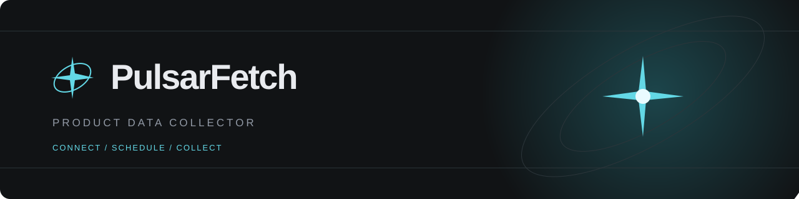
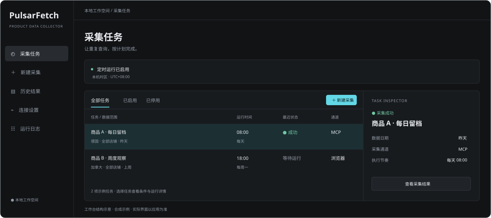

<div align="center">



### 商品数据，按计划到达。

领星 ERP 商品数据采集工具 · Windows / macOS · 浏览器 / MCP

[](https://github.com/impartOvo/win-lingxing-search/releases/latest)
[](https://github.com/impartOvo/win-lingxing-search/actions/workflows/build-windows.yml)
[](LICENSE)

**[下载安装](#下载安装) · [快速开始](#快速开始) · [MCP 教程](#mcp-使用教程) · [定时采集](#定时采集) · [文档](#文档与支持)**

</div>

---

PulsarFetch 将商品查询变成可重复运行的采集任务：选定商品、国家、店铺与日期，立即采集或按计划执行，再把查询上下文和业务数据一起保存为 JSON，供运营人员或 AI 后续分析。

<p align="center">
  
  <br><sub>工作台结构示意 · 合成示例，实际界面以应用为准</sub>
</p>

## 为重复查询而设计

| 能力 | 使用体验 |
| :--- | :--- |
| **双通道采集** | 使用专用 Chrome 登录，或通过独立 MCP 客户端直接取数 |
| **按条件取数** | ASIN、父 ASIN、SKU、MSKU、FNSKU、SPU、品名，结合国家、店铺和日期筛选 |
| **定时与并发** | 每项任务独立设置星期、时间和动态日期；同刻任务分别运行、分别留档 |
| **运行可追溯** | 任务详情展示最近状态、耗时、下次执行及错误，支持查看结果与日志 |
| **数据可交付** | 销售、流量、退货退款、广告、库存和响应附带的关联 MSKU；保留来源与查询条件 |
| **本地工作空间** | 历史结果保存在本机，可查看采集信息和原始 JSON，再交给自己的分析工具 |

采集内容为领星「产品表现」的所选期间汇总，字段取决于账号权限与实际响应。应用负责采集、展示和留档，经营分析由使用者或接收文件的 AI 完成。[查看数据口径 →](docs/data-format.md)

## 下载安装

| 平台 | v1.4.0 安装包 | 启动方式 |
| :--- | :--- | :--- |
| Windows x64 | [下载 ZIP](https://github.com/impartOvo/win-lingxing-search/releases/download/v1.4.0/PulsarFetch-1.4.0-windows-x64.zip) | 完整解压后运行 `PulsarFetch.exe` |
| macOS · Apple 芯片 | [下载 ARM64 ZIP](https://github.com/impartOvo/win-lingxing-search/releases/download/v1.4.0/PulsarFetch-1.4.0-mac-arm64.zip) | 将 `PulsarFetch.app` 放到固定位置后打开 |
| macOS · Intel | [下载 x64 ZIP](https://github.com/impartOvo/win-lingxing-search/releases/download/v1.4.0/PulsarFetch-1.4.0-mac-x64.zip) | 将 `PulsarFetch.app` 放到固定位置后打开 |

[全部版本与 SHA256 校验文件](https://github.com/impartOvo/win-lingxing-search/releases) · [更新记录](docs/release-notes.md)

Windows 需要 .NET Framework 4.8 / 4.8.1；Mac 需要 macOS 13 或以上。安装包包含运行时，无需另外安装 Node.js 或 Python。**浏览器通道**另需安装 Google Chrome；MCP 通道使用领星提供的服务地址和授权。

<details>
<summary>Mac 首次打开、旧版升级与数据目录</summary>

- Mac 包采用 ad-hoc 签名，未经过 Apple Developer ID 签名或公证。首次打开遇到系统提示，请参考 [Mac 发布说明](docs/mac-release-notes.md)。
- Windows 更新前等待采集结束并关闭应用，将新程序及依赖复制到原目录，保留 `results/` 和 `.private/`。便携包需保留完整目录。
- Mac 继续使用 `~/Library/Application Support/Lingxing Search/`，以继承旧版登录、任务、密钥与历史数据。
- 新版启动时按原任务配置同步系统启动路径；已有浏览器任务不会自动切换到 MCP。迁移详情见 [工作台说明](docs/workbench.md)。

</details>

## 快速开始

1. **连接数据源**：在「连接设置」配置 MCP，或准备好浏览器通道的专用 Chrome 登录。
2. **新建采集**：选择通道、标识类型和匹配方式，填写商品、国家、店铺及日期；右侧会预览本次条件。
3. **开始采集**：成功后查看商品数据、采集信息与原始 JSON，核对范围和币种。
4. **保存节奏**：常用查询可点击「设为定时任务」，以后按保存的星期和时间执行。

### 选择适合自己的通道

| | MCP 直接采集 | 浏览器采集 |
| :--- | :--- | :--- |
| 首次准备 | 领星 MCP 服务地址、有效密钥及数据权限 | 已安装 Chrome，能登录领星 |
| 取数方式 | 软件独立连接 MCP 服务，调用受支持的只读工具 | 专用 Chrome 应用筛选并读取产品表现 |
| 日常运行 | 无需保持 Codex 或 Chrome 打开 | 自动打开自己的浏览器会话并复用保存的登录态 |
| 授权失效 | 更新连接密钥，再测试 | 在一次手动采集中重新登录 |
| 定时支持 | 支持 | 支持 |

浏览器首次采集时，请在程序打开的 Chrome 中登录并进入「产品表现」。普通 Chrome 的登录状态与应用专用会话可能不同。

## MCP 使用教程

### 1. 准备连接信息

需要领星提供的 **MCP 服务地址、访问密钥和相应数据权限**。本软件内置 MCP 客户端，不需要额外配置大模型 API Key。

### 2. 在「连接设置」保存授权

**方式 A · 从 Codex 导入**

本机 Codex 已配置名为 `lingxing` 的远程 MCP 服务时，点击「从 Codex 导入」。软件读取受支持的地址与认证头，另存一份独立连接，不修改 Codex 配置；导入后日常采集不依赖 Codex 运行。

**方式 B · 手动填写**

| 字段 | 填写方式 |
| :--- | :--- |
| 服务地址 | 使用领星实际提供的完整 HTTPS MCP 地址 |
| 认证头 | 通常为 `X-Mcp-Key`；服务要求 Bearer 时选择 `Authorization` |
| 连接方式 | 保持 `auto`，或按服务要求选择 `http` / `sse` |
| 密钥 | 填写该服务对应的有效访问密钥 |

点击「保存连接」，再点击「测试已保存连接」。测试会验证独立连接、国家店铺查询和产品表现工具定义。**连接成功后仍需实际采集一次，核对目标商品是否在授权范围内。**

密钥保存后不回显；地址和认证头不变时，密钥留空表示保留原值。更换地址或认证头需重新填写密钥。测试使用已保存的配置，请先保存编辑。

### 3. 完成第一次 MCP 采集

1. 进入「新建采集」，通道选择「MCP 直接采集」。
2. 根据输入选择标识类型，例如按本地品名查询时选择「品名」，确定完整标识时可使用精确匹配。
3. 填写商品、国家及店铺。店铺可留空；填写片段时需能唯一匹配。
4. 选择日期，例如「前 7 天」；币种通常可留为自动，跨币种范围需明确选择统计币种。
5. 点击「开始采集」，完成后在「采集信息」核对来源、国家店铺、日期和币种。

品名会先通过 Listing 解析匹配父 ASIN，再读取产品表现；一个品名可能关联多个父体。FNSKU 在指定范围内需能唯一解析为 MSKU。空响应或接口失败会明确报错，不会当作零销量保存。

### 4. 让 MCP 按时采集

点击「设为定时任务」，确认通道为 MCP，保存任务名称、日期范围、星期及时间，再开启「定时运行」。已有任务也可以通过「修改采集条件」切换通道并保存；只保存连接不会改变旧任务。

完整授权、数据口径、限流及凭据存储说明见 [MCP 客户端文档](docs/mcp-client.md)。

## 定时采集

```text
保存查询条件  →  设置星期与时间  →  启用任务与定时总开关
                                      ↓
查看结果与日志  ←  保存独立结果对  ←  到点采集
```

| 示例任务 | 通道 | 时间 | 数据日期 |
| :--- | :--- | :--- | :--- |
| 商品 A · 每日留档 | MCP | 每天 08:00 | 昨天 |
| 商品 B · 周度观察 | 浏览器 | 每周一 18:00 | 上周 |

以上仅为填写示例。到期任务分别启动，保存各自的运行记录和结果；页面可立即运行单项或全部启用任务。后台按设定时间触发，不再每分钟启动空检查。

| 日期选项 | 读取范围 |
| :--- | :--- |
| 昨天 | 上一个自然日 |
| 前 7 / 30 天 | 截至昨天，不含今天 |
| 近 7 / 30 天 | 包含今天，当天数据可能未完整 |
| 本周 / 本月 | 本周周一 / 本月 1 日至今天 |
| 上周 / 上月 | 上一个完整自然周 / 自然月 |
| 今天 / 固定日期 | 当天 / 指定起止区间 |

动态日期在每次触发时重新计算。**「设为定时任务」保留所选动态范围；编辑器的「使用当前采集条件」复制明确起止日期后会选为固定日期，需要滚动时请重新选择动态范围。**

关闭主窗口后仍可定时执行，电脑需开机、当前用户已登录且未休眠。错过的时间不补跑；暂停只停止后续触发，已开始的采集继续完成。MCP 遇到明确 `429` 限流会有限重试，其他失败见任务详情和日志。[调度机制与进阶操作 →](docs/automation.md)

## 结果与 AI 工作流

每次采集生成一组后缀一致的文件：

```text
results/
├── mcp-<同一次采集标识>.json          # 来源、条件、日期、分页与耗时
└── mcp-data-<同一次采集标识>.json     # 业务数据，商品列表位于 data.list
```

浏览器结果使用 `browser-` / `browser-data-` 前缀。多任务可能交错完成，请按完整后缀配对。把同一组 JSON 交给支持读取文件的 AI，并说明业务问题，即可继续分析。

核对时保留几个口径：空值与零值分开；退货与退款分开；不同币种金额不直接相加；父体汇总与关联 MSKU 不重复汇总；库存按采集时快照理解。详细提示词、命令行调用和跨期比较见 [AI 工作流](docs/ai-workflow.md)。

## 数据保存在你自己的工作空间

| 位置 | 内容 |
| :--- | :--- |
| `results/` | 采集结果与查询上下文 |
| `.private/automation/` | 任务配置、运行记录及日志 |
| `.private/mcp/connection.json` | 本机 MCP 授权配置 |
| `.private/` 中的其他文件 | 浏览器登录态等私有资料 |

Windows 用当前用户 DPAPI 加密 MCP 密钥，迁移到其他用户或电脑需重新配置。Mac 使用仅当前用户可读写的私有文件，当前未集成 Keychain 加密。密钥不写入业务结果，也不作为进程命令行参数传递。公开仓库或反馈问题时，请排除 `.private/` 和真实业务结果。[隐私与迁移说明 →](docs/privacy.md)

## 常见问题

<details>
<summary>MCP 测试失败或采集没有匹配商品</summary>

先检查完整服务地址、认证头、密钥权限和网络，并确认已保存。连接测试通过只代表连接及工具检查成功，具体商品仍取决于授权范围和查询条件。核对标识类型、国家、店铺与精确／模糊匹配；品名匹配不到时可尝试已确认的完整父 ASIN。

</details>

<details>
<summary>出现 429、登录失效或任务失败</summary>

`429` 表示服务端限流，MCP 客户端会有限等待重试。浏览器登录失效时，重新做一次手动采集并在专用 Chrome 中登录。其他错误从任务详情进入运行日志查看，不要把失败解释为零销量。

</details>

<details>
<summary>关闭软件后没按时运行</summary>

检查任务开关与定时总开关、本机时区、运行星期、下次执行，以及电脑是否开机、用户是否已登录并保持唤醒。搬动应用前先暂停定时，在固定的新位置打开后重新启用并核对系统计划。错过的分钟不补跑。

</details>

## 开发与构建

Windows 使用 C# / WPF，Mac 使用 Electron，公共采集与调度逻辑运行在 Node.js。MCP 客户端基于官方 TypeScript SDK。开发需要 Node.js 24 与 npm；Windows 另需 .NET Framework 编译器，Mac 另需 Xcode 命令行工具。

```sh
git clone https://github.com/impartOvo/win-lingxing-search.git
cd win-lingxing-search
npm ci
npm test
```

<details>
<summary>Windows 编译、自检与打包</summary>

```powershell
powershell.exe -NoProfile -ExecutionPolicy Bypass -File desktop/build-exe.ps1
powershell.exe -NoProfile -ExecutionPolicy Bypass -File desktop/test-exe.ps1 -Mode self-test
powershell.exe -NoProfile -ExecutionPolicy Bypass -File desktop/test-exe.ps1 -Mode smoke-test
powershell.exe -NoProfile -ExecutionPolicy Bypass -File desktop/package-windows.ps1
```

仅构建 Windows 时可用 `npm ci --omit=dev` 安装运行依赖。打包后生成 ZIP、SHA256 文件，并检查解压后的应用。

</details>

<details>
<summary>macOS 开发与打包</summary>

```sh
bash mac/make-icon.sh
npm run mac:dev
npm run mac:pack -- --arm64 --dir
# Intel 使用 --x64
```

</details>

v1.4.0 的 Windows x64、Mac ARM64、Mac x64 发布构建、自检和解压检查均已通过；公共逻辑有 27 项回归测试。云端使用合成数据，Mac 真实账号采集与系统定时仍需实机验证。源码后续提交与已发布安装包分别管理，普通 push 不会改写已有 Release。

## 文档与支持

| 想做什么 | 查看文档 |
| :--- | :--- |
| 配置 MCP、理解权限和数据口径 | [MCP 客户端](docs/mcp-client.md) |
| 设置任务、日期、星期与并发 | [自动化说明](docs/automation.md) |
| 理解字段与结果配对 | [数据格式](docs/data-format.md) |
| 把采集数据交给 AI | [AI 工作流](docs/ai-workflow.md) |
| 升级、迁移与界面说明 | [工作台](docs/workbench.md) · [隐私](docs/privacy.md) |
| 查看修复与版本记录 | [Bug 修复记录](docs/bugfix-log.md) · [更新记录](docs/release-notes.md) |

遇到问题可提交 [Issue](https://github.com/impartOvo/win-lingxing-search/issues)，附上系统、版本、复现步骤及去除敏感信息后的错误日志。`main` 与 `mac` 保留完整项目源码，`main0.9` / `mac0.9` 为历史备份。

## License

项目原创代码采用 [MIT](LICENSE) 许可。第三方依赖遵循各自许可证，见 [THIRD_PARTY_NOTICES.md](THIRD_PARTY_NOTICES.md)。
